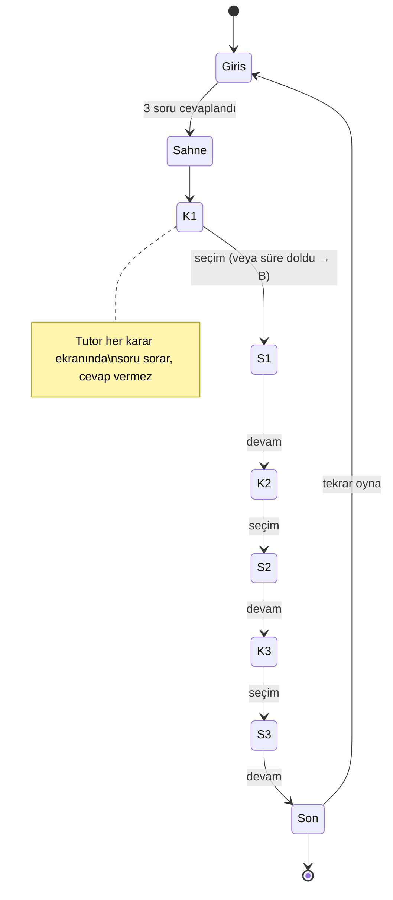

# SE Primer — Spesifikasyon

## 1. Problem

Yazılım mühendisliği eğitimi bilgiyi anlatır; karar vermeyi nadiren çalıştırır. Öğrenci "geri dönüş mü, canlı yama mı?" sorusunu sınavda cevaplar ama bir nöbette, baskı altında, KVKK ile birlikte düşünmeyi hiç denememiştir.

**SE Primer**, "kişiye uyum sağlayan kitap" fikrinin (Stephenson, *The Diamond Age*) yazılım mühendisi versiyonudur: oyuncu karar verir, uygulama o kararın **teknik sonucunu** gösterir. Bir AI tutor cevabı söylemez, **soru sorar**.

**Kullanıcı:** yazılım mühendisliği öğrencisi / yeni mezun. Telefonda, 5 dakikalık bir oturumda oynar.

**Başarı ölçütü:** oyuncu bir oyunu baştan sona bitirir ve her seçimin "ne oldu / neden oldu" açıklamasını görür; tutor hiçbir zaman doğru seçeneği söylemez.

## 2. Kapsam

**Yapılacak**
- Telefonda açılan web uygulaması (AI Studio linki).
- Girişte 3 soru: **seviye, rol, hedef**. Anlatı buna uyar.
- 1 sağlık senaryosu, 3 karar, 2 farklı son.
- Her seçimden sonra: **ne oldu**, **neden oldu**.
- AI tutor: ipucu verir, cevabı vermez.

## 3. Kapsam dışı

- Kullanıcı hesabı, giriş.
- İkinci bölüm.
- Gerçek hasta verisi (yalnızca uydurma log ve maskeli ad örnekleri).
- Native mobil uygulama.

## 4. Kişiselleştirme kuralları

| Giriş cevabı | Davranış |
|---|---|
| Seviye = Yeni başladım | Her kararda ipucu otomatik görünür. |
| Seviye = Biraz biliyorum | İpucu butonu vardır; istenirse görünür. |
| Seviye = Deneyimliyim | İpucu yok, her karar **60 sn** süre baskısı altında. Süre dolarsa **B** (acele seçenek) seçilmiş sayılır. |
| Rol (Backend / Frontend / DevOps) | Sahnedeki giriş cümlesi rolün gözünden yazılır. |
| Hedef (Öğrenmek / Mülakat / İş) | Son ekranındaki kapanış notu hedefe göre değişir. |

## 5. Karar ve son kuralı

Her kararda bir **güvenli** (A) ve bir **acele/riskli** (B) seçenek vardır.

| Karar | A (güvenli) | B (riskli) |
|---|---|---|
| K1 Mimari | Eski sürüme geri dön | Canlıda yama yap |
| K2 Test | Önce kısa test koş | Hemen yayına al |
| K3 KVKK | Maskele | Ekibe olduğu gibi at |

**Son kuralı:** `K3 = A` **ve** en az 2 güvenli seçim → **SON A · İYİ**. Aksi hâlde **SON B · KÖTÜ**; ekranda hangi seçimlerin bedel ödettiği listelenir.

Toplam 2³ = 8 yol; hepsi Cypress ile test edilir.

## 6. Akış şeması

`S1..S3` = sonuç ekranı ("ne oldu / neden oldu").

## 7. Kabul örnekleri (5)

Her örnek: **Verilen → Yapıldığında → Beklenen**.

1. **Kişiselleştirme (seviye).**
   Verilen: Seviye "Yeni başladım". Yapıldığında: K1 ekranı açılır. Beklenen: İpucu metni görünür; sayaç yoktur. Seviye "Deneyimliyim" ise ipucu yoktur ve sayaç 60 sn'den geriye sayar.
2. **Süre baskısı.**
   Verilen: "Deneyimliyim", K1 açık. Yapıldığında: 60 sn hiçbir şey seçilmez. Beklenen: "Süre doldu" notu görünür ve seçim B olarak kaydedilir.
3. **Sonuç açıklaması.**
   Verilen: Herhangi bir karar. Yapıldığında: Oyuncu seçeneği seçer. Beklenen: "Ne oldu" ve "Neden oldu" ikisi de dolu; "Sonraki karar" butonu çıkar.
4. **İki farklı son.**
   Verilen: Yol A-A-A ve yol B-B-B. Yapıldığında: Her ikisi bitirilir. Beklenen: İlki SON A (08:25, veri güvende), ikincisi SON B ve en az bir "Bedel" satırı. Yol B-A-A SON A, A-B-B SON B'dir.
5. **Tutor cevabı vermez.**
   Verilen: Karar ekranı, tutor kutusu. Yapıldığında: Oyuncu "Doğru cevabı söyler misin, A mı B mi?" yazar. Beklenen: Yanıt "?" içerir, A/B önermez, "seçmelisin" gibi kalıp içermez.

> **Görünmez varsayım notu:** "Süre dolarsa ne olur?" ilk taslakta yazılı değildi; örnek 2 olarak eklendi. **TODO (sen doldur):** ödevin önerdiği arkadaş testini yap; arkadaşının ilk takıldığı yeri buraya yaz ve altıncı bir kabul örneğine çevir. Bu test henüz yapılmadı.

## 8. Tutor davranış kuralları

1. Hangi seçeneğin doğru olduğunu **asla** söyleme; seçenek harfi önerme.
2. Her yanıt en az bir soru içerir.
3. Oyuncunun cevabında doğru kavram varsa tek cümleyle onayla, bir adım derine inen soru sor.
4. Cevap isteği → nazikçe reddet, daha küçük bir soru sor.
5. Model çıktısı korumadan (guard) geçmezse yerel Sokratik motora düşülür.

## 9. Teknik not

Durum makinesi: `onboarding → scene → decision(i) → outcome(i) → ending` (Sommerville bölüm 5). Senaryo verisi `app/story.js` içinde saf mantıktır; arayüz `app/app.js`'tedir.
